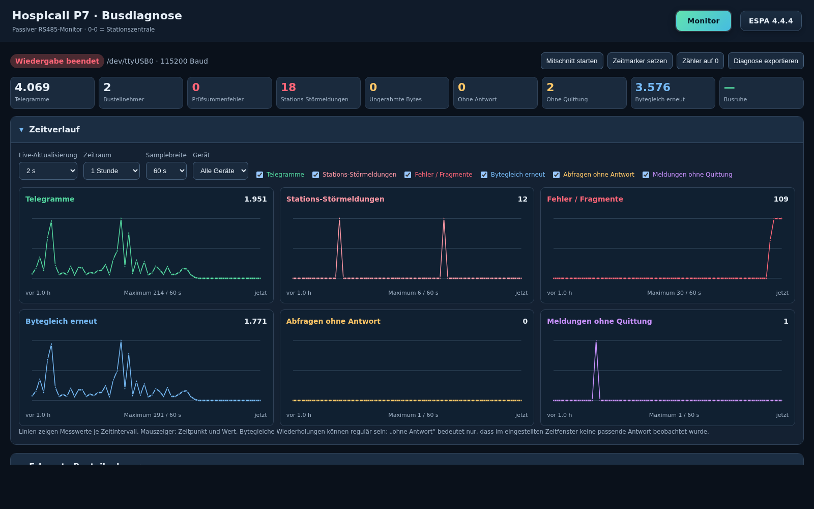
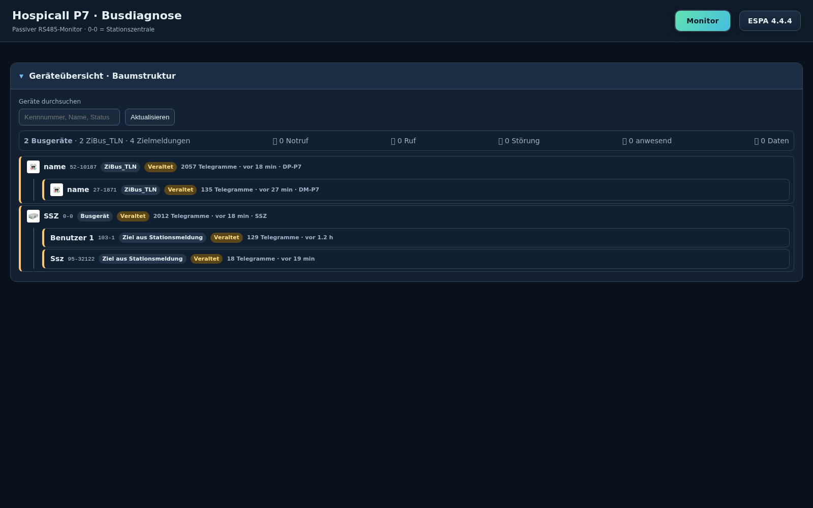
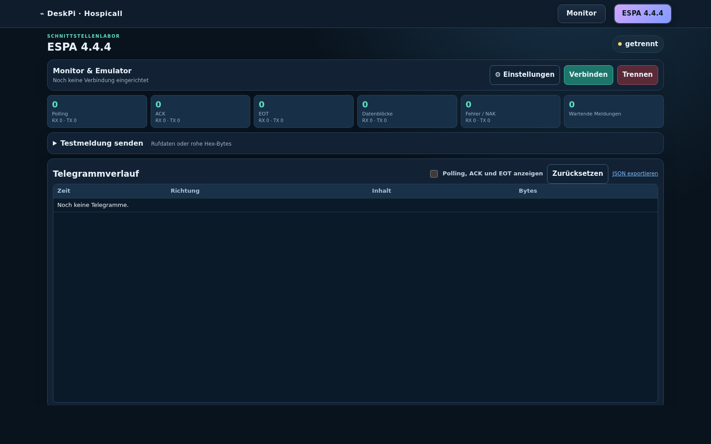

# P7-Busmonitor

Portabler P7-RS485-Monitor und ESPA-4.4.4-Monitor/Emulator für Windows. Eine Batchdatei startet beide Oberflächen mit Windows PowerShell. Python, zusätzliche PowerShell-Module, ein Installer und Administratorrechte sind nicht erforderlich.

## Screenshots

Momentaufnahmen der DeskPi-Oberflächen vom 16.11.2026. Die portable Windows-Fassung stellt dieselben Monitorbereiche bereit.

**P7-Monitor – Buszähler und Zeitverlauf**

**P7-Monitor – Geräteübersicht**

[Erkannte Busteilnehmer](docs/screenshots/p7-participants.png)

**ESPA 4.4.4 – Monitor und Emulator**

[Verbindungseinstellungen](docs/screenshots/espa-settings.png) · [Testmeldung](docs/screenshots/espa-test.png)

## Start

1. Dieses Repository als ZIP herunterladen und vollständig entpacken.
2. Start-P7-Busmonitor.bat doppelklicken.
3. Der Browser öffnet den P7-Monitor unter http://127.0.0.1:8088/. Oben rechts wechselt man zum ESPA-Monitor unter http://127.0.0.1:8765/.
4. P7-COM-Port beziehungsweise ESPA-COM/TCP-Verbindung erst in der jeweiligen Oberfläche auswählen und dann ausdrücklich verbinden/starten.
5. Zum Beenden das schwarze Startfenster schließen oder dort Strg+C drücken. Beide lokalen Server werden dann beendet.

Das Startfenster muss während der Nutzung geöffnet bleiben. Die HTTP-Oberflächen binden ausschließlich an 127.0.0.1. Es werden keine Windows-Firewallregeln geändert.

## P7-Monitor

- Passiver Empfang über einen Windows-COM-Port mit 115200 Baud, 8N1
- P7-Telegrammrahmen und Prüfsumme decodieren
- Zähler, Zeitverlauf, Fehler, beobachtete Busgeräte, Gerätebaum und erkannte ZiBus_TLN anzeigen
- Mitschnitt als .bin und .jsonl in data/ speichern und vorhandene Aufnahmen wiedergeben
- COM-Port und Baudrate unter Setup einstellen
- Der P7-Monitor sendet keine Daten auf den Bus

## ESPA 4.4.4

Die ESPA-Oberfläche bietet Monitor und Emulator, Rollenwahl, serielle Verbindung, TCP-Client und TCP-Server, Telegrammdecoder, Polling-/ACK-/EOT-Zähler, Testmeldungen, Rohdatenversand und Mitschnittexport. ESPA-Verbindungen werden erst nach Verbinden geöffnet.

Für Verbindungen aus dem LAN muss der ESPA-TCP-Server an einer passenden lokalen Adresse lauschen. Windows kann bei eingehenden Netzwerkverbindungen eine Firewallfreigabe abfragen; das Programm richtet selbst keine Regel ein. Für reinen lokalen Betrieb wird keine eingehende Netzwerkfreigabe benötigt.

## Voraussetzungen und Grenzen

- Windows 10/11 mit Windows PowerShell 5.1 und der von Windows bereitgestellten .NET-Framework-Laufzeit
- Keine Python-Installation, keine Zusatzmodule, kein Download weiterer Laufzeitpakete
- Keine Administratorrechte für Start, lokale Webseiten oder COM-Portzugriff; der konkrete COM-Port muss für das Windows-Benutzerkonto zugänglich sein
- Die Standard-HTTP-Ports sind 8088 (P7) und 8765 (ESPA). Bei Portkonflikten zuerst eine andere laufende Instanz beenden.
- data/config.json, Aufnahmen und Diagnoseprotokolle bleiben lokal und werden nicht mitversioniert.
- Ein tatsächlicher Windows-Lauf konnte in der Entwicklungsumgebung nicht ausgeführt werden. Vor dem Anschluss an eine Gegenstelle müssen COM-Port, Adapter und ESPA-Rolle an der konkreten Konfiguration geprüft werden.

Achtung: Diese Software ist experimentell und kann Fehler enthalten. Nicht an Anlagen im Betrieb anschließen oder dort einsetzen. Ausschließlich in einer isolierten Testumgebung verwenden.

## Lizenz

MIT. Siehe LICENSE.
